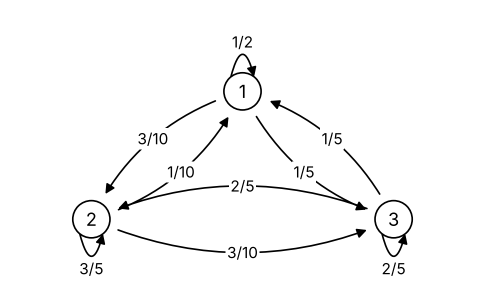

---
tags:
    - Markov Chains
    - Transition Matrix
    - Multi-Step Probabilities
    - Simulation
---

<h1 align="center">Markov Chains</h1>

Markov chains model state-based systems in which the next state is conditionally independent of the earlier past given the current state. The Poisson process in Session 7 forgets its past completely; a Markov chain remembers exactly one thing, the current state. We connect conditional probability, matrices, stochastic processes, and simulation.

A chain is specified by a state space, a transition matrix, and an initial distribution. Path probabilities multiply along a route, and the distribution of the chain after several steps comes from powers of the matrix. Simulating the chain step by step makes the same distributions visible and checks every calculation.

#### Key Concepts

- Markov property and time homogeneity
- State space, transition matrix, and transition diagram
- Path probabilities
- Distribution of \(X_n\) and \(n\)-step transition probabilities
- Simulation of a chain

!!! tip "Learning Objectives"

    - Define a state space and transition matrix, and draw the transition diagram.
    - Calculate path probabilities and joint probabilities at several times.
    - Calculate the distribution of \(X_n\) and \(n\)-step transition probabilities with matrix powers.
    - Simulate a Markov chain and compare the simulated frequencies with the exact distribution.

### Session Preparation:

Review conditional probability and the law of total probability from [Session 1](../01_Probability_Foundations/README.md), matrix multiplication from the [prerequisites](../00_Prerequisites/README.md), and the state space and index set of a process from [Session 7](../07_Stochastic_Processes_and_Poisson_Processes/README.md).

**Syllabus and input**

- [ProbabilityCourse 11.2.1: discrete-time Markov chains](https://www.probabilitycourse.com/chapter11/11_2_1_introduction.php)
- [State-transition matrix and diagram](https://www.probabilitycourse.com/chapter11/11_2_2_state_transition_matrix_and_diagram.php)
- [State probability distributions](https://www.probabilitycourse.com/chapter11/11_2_3_probability_distributions.php)

**Session material**

### Exercises

#### Exercise 1 — Paths and transitions

Consider the Markov chain with three states, \(S=\{1,2,3\}\), that has the following transition matrix

\[
P=\left[\begin{array}{ccc}
\frac{1}{2} & \frac{1}{4} & \frac{1}{4} \\
\frac{1}{3} & 0 & \frac{2}{3} \\
\frac{1}{2} & \frac{1}{2} & 0
\end{array}\right]
\]

1. Draw the state transition diagram for this chain.
2. If we know \(P\left(X_1=1\right)=P\left(X_1=2\right)=\frac{1}{4}\), find \(P\left(X_1=3, X_2=2, X_3=1\right)\).

???answer
    <ol start="2">
        <!-- element b -->
        <li style> 1/12 </li>
    </ol>

#### Exercise 2 — Distribution after n steps

A chain on \(S=\{1,2,3\}\) has transition matrix and initial distribution

\[
P=\begin{pmatrix}
0.5&0.3&0.2\\
0.2&0.6&0.2\\
0.1&0.3&0.6
\end{pmatrix},
\qquad
\pi^{(0)}=\begin{pmatrix}0.2&0.5&0.3\end{pmatrix}.
\]

1. Find \(\pi^{(1)}\) and \(\pi^{(2)}\).
2. Find \(P(X_3=1\mid X_1=3)\).
3. Find \(P(X_0=2, X_2=2, X_3=3)\).

??? answer

    \(\pi^{(1)}=(0.23,\,0.45,\,0.32)\) and \(\pi^{(2)}=(0.237,\,0.435,\,0.328)\). Part 2 is \(p^{(2)}_{31}=0.17\). Part 3 is \(\pi^{(0)}_2\,p^{(2)}_{22}\,p_{23}=0.2\cdot0.48\cdot0.2=0.048\).

#### Exercise 3 — A two-state reliability chain

A component is either Working or Failed. During each hour, a working component fails with probability 0.02, while a failed component is repaired with probability 0.30.

1. Construct the transition matrix and diagram.
2. Starting in Working, find the probability of being Failed after 2 and 10 hours.
3. Simulate 10,000 paths of 10 hours starting in Working and compare the fraction of paths that are Failed after 10 hours with part 2.

??? answer

    With state order \((W,F)\), \(P=\begin{pmatrix}0.98&0.02\\0.30&0.70\end{pmatrix}\). The probabilities of being Failed are \(p^{(2)}_{WF}=0.0336\) and \(p^{(10)}_{WF}\approx0.0612\).

#### Exercise 4 — Reading a transition diagram

Consider the Markov chain with state space \(S=\{1,2,3\}\) in the figure below.

1. Write down the transition matrix \(P\) and check that every row sums to 1.
2. Find the probability that the chain is in state 3 two steps after being in state 1, i.e. \(p^{(2)}_{13}\). List the paths and add their probabilities.
3. Assume \(\pi^{(0)}=(0.5,\,0.3,\,0.2)\). Find \(\pi^{(2)}\) and \(P(X_0=1,X_1=2,X_2=3)\).
4. Verify part 2 with \(P^2\) in Python.

???answer
    1. \(P=\begin{pmatrix}0.5&0.3&0.2\\0.1&0.6&0.3\\0.2&0.4&0.4\end{pmatrix}\)
    2. \(p^{(2)}_{13}=0.5\cdot0.2+0.3\cdot0.3+0.2\cdot0.4=0.27\)
    3. \(\pi^{(2)}=(0.255,\,0.450,\,0.295)\) and \(P(X_0=1,X_1=2,X_2=3)=0.5\cdot0.3\cdot0.3=0.045\)

#### Exercise 5 — Estimating a transition matrix

An observed state sequence is

\[
A,A,B,A,C,C,B,C,C,A,B,B,C,A,A.
\]

1. Count all observed one-step transitions.
2. Estimate the transition matrix by row-normalising the counts.
3. State which rows have the greatest estimation uncertainty and why.
4. Simulate a sequence of length 100 from the fitted chain and compare transition frequencies.
