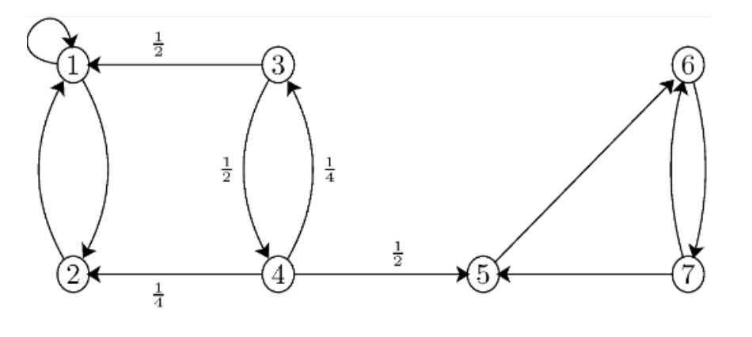
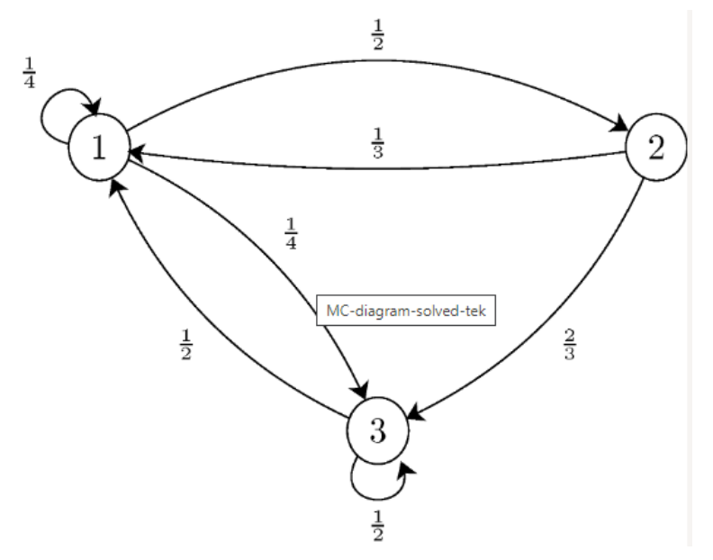
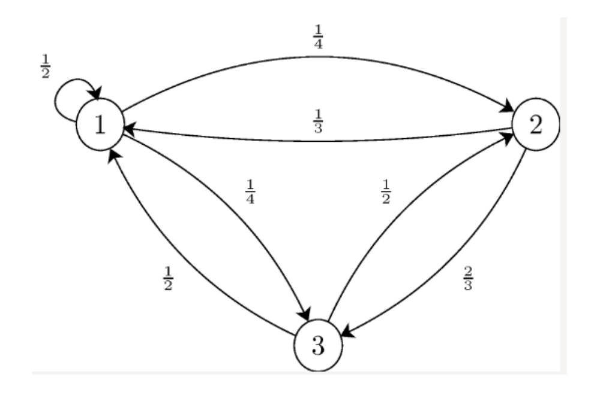

---
tags:
    - Markov Chains
    - Stationary Distribution
    - Absorption
    - Classification of States
---

<h1 align="center">Markov Chains: Long-Run Behaviour</h1>

This session follows a Markov chain over many steps. Where does the chain end up, how long does it take to get there, and what fraction of time does it spend in each state? Conditioning on the first step turns these questions into systems of linear equations.

Classification of states decides which long-run questions make sense. In a chain with absorbing states, we calculate absorption probabilities and expected absorption times by recursion with the law of total probability. In an irreducible and aperiodic chain, the stationary distribution is also the limiting distribution, gives the long-run proportion of time spent in each state, and determines the mean return times. Simulation checks every analytical result.

#### Key Concepts

- Communicating classes, closed classes, and absorbing states
- Transience, recurrence, periodicity, and irreducibility
- Recursion with the law of total probability
- Absorption probabilities, expected absorption times, and mean return times
- Stationary versus limiting distributions
- Long-run proportions of time and their simulation

!!! tip "Learning Objectives"

    - Classify the states of a Markov chain and identify closed classes.
    - Use first-step analysis to find absorption probabilities, expected absorption times, and mean return times.
    - Calculate a stationary distribution and decide when it is also a limiting distribution.
    - Interpret stationary probabilities as long-run proportions and verify them by simulation.

### Session Preparation:

Attempt the exercises from [Session 8](../08_Markov_Chains/README.md#exercises).

**Syllabus and input**

- [Classification of states](https://www.probabilitycourse.com/chapter11/11_2_4_classification_of_states.php)
- [The law of total probability and recursion](https://www.probabilitycourse.com/chapter11/11_2_5_using_the_law_of_total_probability_with_recursion.php)
- [Stationary and limiting distributions](https://www.probabilitycourse.com/chapter11/11_2_6_stationary_and_limiting_distributions.php)

**Session material**

### Exercises

#### Exercise 1 — Classification of states

Consider

\[
P=\begin{pmatrix}
1&0&0&0\\
0.2&0.5&0.3&0\\
0&0&0.6&0.4\\
0&0&0.1&0.9
\end{pmatrix}.
\]

1. Draw the transition diagram.
2. Identify the communicating classes.
3. Classify states as transient or recurrent.
4. Identify all closed classes and stationary distributions.

??? answer

    State 1 is an absorbing closed class. States 3 and 4 form another closed irreducible class. State 2 is transient because it can leave for either closed class and cannot be revisited from them. Each closed class supports a stationary distribution.

#### Exercise 2 — Absorption in recurrent classes

Consider the Markov chain in the figure below. There are two recurrent classes, \(R_1=\{1,2\}\), and \(R_2=\{5,6,7\}\).

1. Assuming \(X_0=3\), find the probability that the chain gets absorbed in \(R_1\).
2. Find the expected time (number of steps) until the chain gets absorbed in \(R_1\) or \(R_2\). More specifically, let \(T\) be the absorption time, i.e., the first time the chain visits a state in \(R_1\) or \(R_2\), so find \(E\left[T \mid X_0=3\right]\)

???answer
    1. \(a_3=\frac{5}{7}\)
    2. \(t_3=\frac{12}{7}\)

#### Exercise 3 — An absorbing release process

A software change moves among Review, Testing, Released, and Rejected with transition matrix

\[
P=\begin{pmatrix}
0.3&0.6&0&0.1\\
0.2&0.3&0.4&0.1\\
0&0&1&0\\
0&0&0&1
\end{pmatrix}.
\]

1. Identify transient and absorbing states.
2. Starting in Review, find the probability of eventual release.
3. Find the expected number of steps until absorption.
4. Verify both results by simulation.

#### Exercise 4 — Mean return time

Consider the following Markov chain

Assume \(X_0=1\), and let \(R\) be the first time that the chain returns to state 1 . Find \(E\left[R \mid X_0=1\right]\).

???answer
    \(\frac{8}{3}\)

#### Exercise 5 — Stationary and limiting distributions

Consider the following Markov chain

1. Is this chain irreducible?
2. Is this chain aperiodic?
3. Find the stationary distribution for this chain.
4. Is the stationary distribution a limiting distribution for the chain?

???answer
    1. yes
    2. yes
    3. \(\pi_1 \approx 0.457, \pi_2 \approx 0.257, \pi_3 \approx 0.286\)
    4. yes

#### Exercise 6 — The reliability chain in the long run

Use the Working/Failed chain from [Session 8, Exercise 3](../08_Markov_Chains/README.md#exercise-3-a-two-state-reliability-chain).

1. Find the stationary distribution.
2. Interpret the stationary failure probability operationally.
3. Find the mean return time to Failed and interpret it.

??? answer

    The stationary distribution satisfies \(0.02\pi_W=0.30\pi_F\), giving \((\pi_W,\pi_F)=(15/16,1/16)\). In the long run the component is failed one hour in 16, and the mean return time to Failed is \(1/\pi_F=16\) hours.

#### Exercise 7 — Web-service states

A service is in state Normal, Degraded, or Down. Construct a plausible transition matrix satisfying the following one-step statements: a normal service remains normal with probability 0.92; a degraded service goes down with probability 0.10; and a down service recovers to degraded with probability 0.60. Choose and justify the remaining probabilities.

1. Draw the transition diagram.
2. Calculate the distribution after 5 steps from Normal.
3. Find a stationary distribution.
4. Simulate 10,000 steps and compare empirical state frequencies with the stationary distribution.

#### Exercise 8 — Long-run service availability

Use the transition matrix constructed in Exercise 7.

1. Determine whether the chain is irreducible and aperiodic.
2. Find its stationary distribution.
3. Interpret the long-run proportions of time in Normal, Degraded, and Down.
4. Change one transition probability to represent an improved repair process and quantify the effect on long-run availability.
